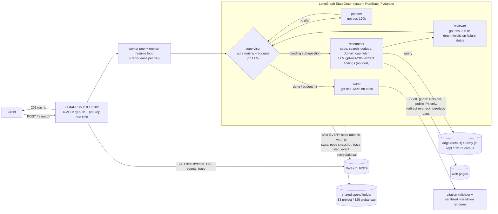

<p align="center">
  <picture>
    <source media="(prefers-color-scheme: dark)" srcset="assets/brand/logo-dark.svg">
    
  </picture>
</p>

<p align="center">
  <b>Deep research that survives a crash, and shows its work.</b><br>
  A LangGraph research-agent service whose run state lives in Redis, whose budgets are enforced in code,
  whose every citation is checked, and whose every step is traced.
</p>

<p align="center">
  
  <br><sub>A real session, $0: local Ollama model, offline fixture corpus, real Redis, real <code>kill -9</code>. <a href="assets/demo/README.md">How it was recorded</a>.</sub>
</p>

<p align="center">
  <a href="https://github.com/niravpatidar37/tracedresearch/actions/workflows/ci.yml"></a>
  <a href="LICENSE"></a>
  
</p>

> **Status: working MVP, measured on a small benchmark.** 16 real research runs and 2 real crash tests,
> all with raw data in [`results/`](results). Runs locally with docker compose; the Cloud Run Terraform and CD
> are deploy-ready but **not applied** (no cloud account connected). Claim-level faithfulness is **not yet
> measured**: a valid citation proves the source exists, not that it supports the sentence. Read
> [What did not work](#what-did-not-work) before relying on it.

## The problem

A research agent is a long-running, multi-step, paid job that reads untrusted text. Each of those properties
breaks something:

- **Processes die mid-run.** Containers get rescheduled: Cloud Run sends `SIGTERM` and kills the instance
  10 seconds later ([container contract](https://cloud.google.com/run/docs/container-contract#instance-shutdown)).
  An agent that keeps its state in memory loses the run, and replaying it re-spends every LLM call.
- **Cost is unbounded by default.** Loops of search, fetch and LLM calls are exactly what OWASP calls
  *Unbounded Consumption* and "denial of wallet" ([LLM10:2025](https://genai.owasp.org/llmrisk/llm102025-unbounded-consumption/)).
  A limit that lives in a prompt is a suggestion.
- **Citations get invented.** Across six studies reviewed by Walters & Wilder, 51% of 732 ChatGPT-generated
  references were fabricated ([Scientific Reports, 2023](https://www.nature.com/articles/s41598-023-41032-5)).
- **Fetched pages are an attack surface.** Indirect prompt injection plants instructions in retrieved content
  ([Greshake et al., 2023](https://arxiv.org/abs/2302.12173)), and search results can point a fetcher at
  internal addresses (SSRF).

## What it does

| | Guarantee | Where |
|---|---|---|
| **Durable** | After **every** graph node, the state, a node snapshot, the trace step and a progress event are written to Redis in one `MULTI`. A killed worker's run is picked up by another worker once its lease expires and continues from the last committed step; completed nodes are not re-run. | [`graph.py`](src/research_assistant/graph.py), [`store.py`](src/research_assistant/store.py) |
| **Bounded** | Sub-questions, searches, total tokens, active wall clock, reviewer send-backs and per-run USD are checked in graph code before every LLM call, plus a shared, file-locked spend ledger with a project and a global cap. Each budget has a test that trips it. | [`runtime.py`](src/research_assistant/runtime.py), [`spend.py`](src/research_assistant/spend.py) |
| **Cited** | Every finding stores claim, URL, a snippet that must appear verbatim on the fetched page, and a timestamp. Report links are rendered by code from those records; every `[^n]` marker is validated and a paragraph without a valid citation is dropped. | [`report.py`](src/research_assistant/report.py) |
| **Traced** | `GET /research/{id}/trace` returns every step: agent, input, output, tool calls with statuses, LLM calls, tokens, latency and the worker pid. | [`api.py`](src/research_assistant/api.py) |
| **Tools in code** | No model has tools. Search and fetch are budgeted code paths behind an SSRF guard (public IPs only, DNS pinning, redirect re-check, size and type caps). | [`fetch/ssrf.py`](src/research_assistant/fetch/ssrf.py) |
| **Scoped** | API keys (≥16 chars, constant-time compare, fail closed with 503 when none are set), a per-key rate limit, and runs visible only to the key that created them. | [`api.py`](src/research_assistant/api.py) |

## Results (real runs, raw data committed)

Eight real research questions ([`results/questions.json`](results/questions.json)) go through the HTTP API
(`POST /research`, then the SSE stream, then `GET /research/{id}` and `/trace`). The stack is Groq
`gpt-oss-120b`/`gpt-oss-20b`, DuckDuckGo search (`ddgs`), live page fetching, and Redis 7.

| Metric | v2: failover (8 runs) | v3: fresh LLM cache (8 runs) | **Pooled (16)** |
|---|---|---|---|
| Runs completed | 8/8 | 7/8 (1 planner failed: both models rate-limited) | **15/16** |
| Wall time p50 / p95 (POST to report) | 46.1 / 103.0 s | 94.0 / 122.8 s | **64.8 / 116.5 s** |
| Runs under 5 min | 8/8 | 7/7 | **15/15 completed** |
| Tokens per run, mean (p95) | 9,192 (12,285) | 8,406 (13,375) | **8,825 (12,988)** |
| USD per run, mean (max) | $0.00081 ($0.00133) | $0.00098 ($0.00152) | **$0.00089 ($0.00152)** |
| Searches per run | 5.5 | 5.0 | **5.3** |
| Page fetches per run | 19.1 | 20.0 | 19.5 |
| Findings (claim + url + verbatim snippet + timestamp) per run | 3.75 | 4.0 | 3.9 |
| Citation validity, writer's first draft | 35/35 | 24/24 | **59/59 (100%)** |
| Citation validity, final report (validator gate) | 38/38 | 34/34 | **72/72 (100%)** |
| Sub-questions the reviewer accepted | 14/25 | 13/21 | 27/46 |
| Reviewer send-backs (max 1 per sub-question) | 11 | 10 | 21 |
| Deterministic fallback reports (writer not run or failed) | 3 | 3 | 6 |
| 429 failovers from 120b to 20b | 9 | 17 | 26 |

- Per-run data: [`results/benchmark_v2_failover/`](results/benchmark_v2_failover),
  [`results/benchmark_v3_json_retry/`](results/benchmark_v3_json_retry), and the pooled summary in
  [`results/benchmark_pooled/summary.json`](results/benchmark_pooled/summary.json). Each `runNN_<id>/` folder has
  `report.md`, `run.json` and `trace.json`.
- v2 reused 10 of 63 LLM calls from the on-disk cache, which costs $0 and makes those calls fast. v3 ran with an
  empty cache, so every call in it is real.
- An earlier v1 (4 runs, [`results/benchmark_v1_no_failover/`](results/benchmark_v1_no_failover)) had no model
  failover. It reached p50 174 s and p95 248 s, and 2 of 4 runs hit the wall-clock ceiling because `gpt-oss-120b`
  was rate-limited. That result is why the failover exists.

### Crash and resume (real process kill)

[`scripts/live_eval.py crash`](scripts/live_eval.py) starts the API, submits a question, waits until steps are
committed, hard-kills the server (`TerminateProcess`: no graceful shutdown) and checks port 8102 is free, then
starts a fresh server whose resume loop picks up the orphaned run once the dead worker's 10 s lease expires.

| Run | Steps committed before kill | Steps after restart | Duplicate node keys | Planner executions | Worker PIDs in trace | Outcome |
|---|---|---|---|---|---|---|
| Groq [`results/crash_resume_groq/`](results/crash_resume_groq) | 6 | 8 | **0** | 1 | 2 (before / after) | completed. Resumed 12 s after the kill, at step 6 |
| Ollama llama3.1:8b [`results/crash_resume_ollama/`](results/crash_resume_ollama) | 4 (killed between researcher and reviewer) | 10 | **0** | 1 | 2 | completed, 10 findings, 11/11 citations valid |

The evidence logs are `crash_resume.log`, `server1.log` and `server2.log`; `server2.log` contains
`run … resumed at step 6 (pid …); completed nodes: [...]`.

Caveat on the Groq run: by then the shared free-tier key was close to its limits. All of the resumed researcher
steps hit `rate limited for 542-669 s past deadline`, so that run finished with 0 findings and a fallback report.
Durability still holds. The Ollama run shows a resumed run that does real research; its 8B writer produced invalid
JSON twice, which also led to a fallback report.

### Tests and checks

- **153 pytest tests**, run in CI with no secrets; every LLM call in them uses recorded/fake responses. Each
  specialist is tested alone, every budget is tested to trip, and there are tests for the SSRF guard (including the
  GCP metadata server), the citation validator, injection handling, crash/resume, API auth, rate limiting and
  ownership, and the deployment controls (readiness, migrations, kill switch, graceful drain, api/worker queue,
  Redis spend ledger).
- **Mutation check** ([`results/mutation_check.txt`](results/mutation_check.txt)): each security or budget control
  is disabled one at a time and the suite must fail for every mutant. The first round left 2 survivors (an IP check
  shadowed by the deny list, and the undefined-footnote check); both were fixed with new tests. Current result:
  **21/21 mutants killed**. The deployment-control set
  ([`results/mutation_check_deploy.txt`](results/mutation_check_deploy.txt)) killed **13/13** after one round.
- CI runs ruff, mypy (strict), pytest, bandit, pip-audit, gitleaks, a Docker build, a Trivy image scan, and for the
  infrastructure `terraform fmt -check`, `init -backend=false` + `validate` (both envs), tflint and checkov.

## Quick start

Requires Python 3.12 via [uv](https://docs.astral.sh/uv/) and Docker. LLM keys come from the environment or from
the env file named by `PORTFOLIO_ENV_FILE`; the variable names are in [`.env.example`](.env.example).

```bash
git clone https://github.com/niravpatidar37/tracedresearch && cd tracedresearch
uv venv --python 3.12 .venv && uv sync --frozen --extra anthropic
docker compose -p p2-research up -d redis                      # redis:7.4.7 on 127.0.0.1:16379
export RESEARCH_API_KEYS="local-$(openssl rand -hex 16)"       # >= 16 chars, or the API fails closed
uv run research-assistant migrate                              # versioned keyspace migrations (once per Redis)
LOG_FORMAT=text uv run uvicorn research_assistant.api:app_factory --factory --host 127.0.0.1 --port 8102

curl -s -X POST localhost:8102/research -H "X-API-Key: $RESEARCH_API_KEYS" -H 'content-type: application/json' \
     -d '{"question":"How do sodium-ion batteries compare with lithium-ion on cost?"}'
curl -N localhost:8102/research/<run_id>/events -H "X-API-Key: $RESEARCH_API_KEYS"   # SSE progress
curl -s localhost:8102/research/<run_id>        -H "X-API-Key: $RESEARCH_API_KEYS"   # status + report
curl -s localhost:8102/research/<run_id>/trace  -H "X-API-Key: $RESEARCH_API_KEYS"   # per-step trace
```

**$0 and offline:** `LLM_PROVIDER=ollama` (llama3.1:8b by default, `OLLAMA_MODEL` to change it) plus
`SEARCH_FIXTURE_FILE=fixtures/redteam_corpus.example.json` serves search and fetch from a local corpus. That is
how the demo above runs; [`assets/demo/session.sh`](assets/demo/session.sh) is the exact script.

Other entry points:
- CLI without the API: `uv run research-assistant run "question"`, then `resume <run_id>` or `show <run_id>`.
- Containers (api + worker split, like the cloud):
  `RESEARCH_API_KEYS=... docker compose -p p2-research --profile api up -d --build`. This runs `migrate` once, then
  starts the API on :8102 and the worker probes on :8112.
- Ops: `uv run research-assistant kill-switch on|off|status` and `uv run research-assistant migrate --check`.
- Tests: `uv run pytest -q`. Live re-measurement: `python scripts/live_eval.py bench` or `python scripts/live_eval.py crash`.
- Stop: `docker compose -p p2-research stop`.

## Architecture



### Design decisions (and what they cost)

1. **A small Redis state store instead of the official LangGraph Redis checkpointer.**
   - I checked first: `langgraph-checkpoint-redis` 0.5.2 fails on plain `redis:7` with `unknown command 'FT.INFO'`
     because it needs RediSearch/RedisJSON ([`results/official_redis_checkpointer_probe.txt`](results/official_redis_checkpointer_probe.txt)).
     Implementing `BaseCheckpointSaver` myself would have meant reproducing langgraph-checkpoint 4.x internals such
     as delta-channel history.
   - Instead, every node is wrapped. The wrapper writes the domain `RunState`, a node snapshot (for idempotent
     re-entry), the trace step and a progress event in one Redis `MULTI`. Supervisor routing is a pure function of
     that state, so resuming means re-invoking the graph with the stored state.
   - *Gave up:* LangGraph time-travel and sub-node granularity. A node that is in flight when the process dies is
     re-run. The LLM disk cache keeps that cheap.
2. **Tools run in code, and the models only read text.** Search and fetch are deterministic code under budgets.
   The extraction model sees page text but has no tools, returns a strict schema, and each snippet must be found
   verbatim on the fetched page or the finding is dropped. The writer has no tools either.
   *Gave up:* agentic flexibility (the researcher cannot decide to follow a link or open a PDF).
   *In return:* an injected page cannot trigger an action.
3. **Model split: 120b for planning and writing, 20b for per-page extraction and review.** Extraction and review
   are high-volume, bounded tasks, and the 20b costs half as much ($0.075/$0.30 vs $0.15/$0.60 per million tokens
   at Groq's paid rates). I did not run an A/B on quality, so this is a judgement, not a measurement. When the 120b
   returns a 429 asking to wait more than 20 s, planner and writer fail over to the 20b for that node (26 times in
   16 runs). Without failover, v1 had p95 248 s over 4 runs; with it the pooled p95 is 117 s over 16 runs. Not a
   controlled A/B: key contention varied between rounds.
4. **The wall-clock ceiling counts active compute time stored in state, not time since creation.** A redeploy that
   takes 10 minutes should not kill a run that has used 40 s. 45 s of the budget is reserved for the writer; after
   that point research stops and the writer runs on whatever findings exist.

### Budgets (enforced in graph code; each has a test that trips it)

| Budget | Default | Enforced in |
|---|---|---|
| max sub-questions | 4 | `planner.build_plan` truncates |
| max searches per sub-question | 2 | `researcher.research` |
| max total tokens (writer reserve 9k) | 40,000 | `AgentContext._guard` before every LLM call (worst case = prompt estimate + max_tokens) |
| wall-clock ceiling (active) | 270 s | `supervisor.route` + per-node deadline passed down to LLM retries |
| reviewer send-backs | exactly 1 per sub-question | `supervisor.route` |
| per-run USD | $0.10 | `AgentContext._guard` |
| shared ledger | $3 project / $25 global | `SpendLedger.check` before every paid call, file-locked JSONL |

Every default can be overridden by an env var (`BUDGET_MAX_SUB_QUESTIONS`, `BUDGET_MAX_SEARCHES_PER_SUBQ`,
`BUDGET_MAX_TOTAL_TOKENS`, `BUDGET_MAX_WALL_CLOCK_S`, `BUDGET_MAX_RUN_USD`, `P2_PROJECT_CAP_USD`, `LLM_SPEND_CAP_USD`).

## Security model

**Threat model.** The main threat is *indirect prompt injection through fetched web pages*; a red-team harness
attacks this service that way (see [`docs/REDTEAM.md`](docs/REDTEAM.md) and the poisoned fixture page in
[`fixtures/redteam_corpus.example.json`](fixtures/redteam_corpus.example.json)). Others: SSRF through
attacker-influenced search results and redirects, cost exhaustion, cross-tenant access to runs, and XSS or phishing
links in the rendered report.

**Controls in code.**
- Fetcher ([`fetch/ssrf.py`](src/research_assistant/fetch/ssrf.py), [`fetch/fetcher.py`](src/research_assistant/fetch/fetcher.py)):
  only http/https on ports 80/443 and no userinfo; DNS is resolved and *every* answer must be a public IP (private,
  loopback, link-local, CGNAT, metadata 169.254.169.254 and fd00:ec2::254, NAT64/6to4/IPv4-mapped and documentation
  ranges are blocked); the connection goes to the validated IP (DNS pinning, with SNI and Host preserved); redirects
  are followed manually (max 3) and re-validated on every hop; 2 MB size cap (declared and streamed), 10/15 s
  timeouts, content-type allowlist, `trust_env=False`; every failure becomes a status (`blocked`, `timeout`,
  `paywalled`, `rate_limited`, `unsupported`, `too_large`, `empty`), never an exception.
- Untrusted text: page text sits inside `<<<PAGE …>>>` data blocks and delimiter strings in the text are
  neutralised first; control and bidi characters are stripped; no model that reads page text can call a tool; each
  extracted snippet must appear verbatim on the page.
- Report output ([`report.py`](src/research_assistant/report.py)): all model text is escaped (HTML becomes
  entities; markdown link, image and heading syntax is escaped; URLs are removed). The only links are footnotes
  rendered by code from Finding records, and every `[^n]` marker is checked before the report is returned.
- API ([`api.py`](src/research_assistant/api.py)): API keys of at least 16 characters compared in constant time
  (503 with no keys configured); fixed-window rate limit per key in Redis; runs visible only to the creating key
  (404 otherwise); run IDs regex-validated; questions limited to 10-500 characters; logs redact PII and secrets.
- Supply chain: `uv.lock`, pip-audit, GitHub Actions pinned by full SHA with `permissions: contents: read`, Docker
  images pinned by digest, a non-root multi-stage image with a healthcheck, scanned by Trivy, and gitleaks.

**Residual risk.**
- An injected page can still shape the *claims* extracted from that page and how the writer words them. Citations
  stay real, but the content can be wrong or slanted. The per-domain cap (2) limits how much one site can dominate.
- Faithfulness is not verified (see below).
- DNS pinning relies on the TLS SNI and hostname check in httpx/httpcore.
- The spend-cap check and the ledger record are not atomic across processes: a concurrent call can overshoot by at
  most one call's worst-case cost.
- There is no robots.txt handling.
- Deployment (not applied yet): with AUTH enabled, the provider stores the Memorystore AUTH string in Terraform
  state (`auth_string`), so the state bucket has to stay private. The API is public at the Cloud Run layer
  (`invoker_iam_disabled`) and relies on app-level API keys plus per-key rate limits; there is no Cloud Armor/WAF.

<details><summary><b>OWASP LLM Top 10 (2025) mapping</b></summary>

| Risk | Status |
|---|---|
| LLM01 Prompt injection | Data delimiting, no tools for models that read page text, verbatim-snippet provenance, citation gate, URL stripping. Residual: claim slanting |
| LLM02 Sensitive info disclosure | No secrets in prompts; secrets only from the env; PII/secret log redaction; runs scoped per API key |
| LLM03 Supply chain | Lockfile, pip-audit, SHA-pinned actions, digest-pinned images, Trivy, gitleaks |
| LLM04 Data/model poisoning | No training. Poisoned web content is handled under LLM01; per-domain cap |
| LLM05 Improper output handling | Pydantic-validated outputs, escaped markdown, code-rendered links only |
| LLM06 Excessive agency | No model has tools; search and fetch are budgeted code paths |
| LLM07 System prompt leakage | Prompts hold no secrets; leaking one has no impact |
| LLM08 Vector/embedding weaknesses | N/A (no vector store) |
| LLM09 Misinformation | Provenance-checked findings and validated citations. Residual: faithfulness not measured |
| LLM10 Unbounded consumption | Graph budgets (tokens, wall clock, searches, sub-questions, send-backs, run USD), shared ledger cap, per-key rate limit, input size limits |

</details>

## What did not work

- **Official Redis checkpointer on plain Redis 7.** It needs Redis Stack modules (see the probe above).
- **Strict JSON-schema mode is not consistent across the two models.** `gpt-oss-120b` returned HTTP 200 with JSON
  that left out a required key (`title`); `gpt-oss-20b` was rejected server-side with `json_validate_failed`.
  Fixes: Pydantic defaults on the non-critical fields, plus one retry in plain JSON mode. In the pooled runs the
  writer still failed validation in 3 runs and was rate-limited out in 1, and 2 runs had no findings at all. Those
  6 runs got the deterministic fallback report, with valid citations whenever there were findings.
- **The shared free-tier Groq key was the bottleneck, not the graph.** The limit is 8k tokens per minute per model
  plus daily caps, shared with other builds running at the same time. `retry-after` values went up to 669 s, and one
  v3 run failed at the planner because both models were limited. Wall times above are an upper bound under contention.
- **Bot walls and empty pages.** 85 of 293 fetches were `blocked` (mostly HTTP 403 from publishers such as Lancet,
  NEJM, JAMA, ScienceDirect) and 23 were `empty` (PubMed/PMC served no extractable text to a non-browser client).
  The biomedical question got 0 findings in v2 and 2 in v3. 17 of 79 DuckDuckGo searches returned "No results
  found" for reasonable queries, which looks like soft rate limiting.
- **A valid citation is not the same as a supported claim.** In the EU AI Act run (v1), the writer said high-risk
  obligations apply from 2 August 2026 and cited a page whose snippet says those rules "apply from 2 December 2027".
  The validator passes it, because it only checks that each citation resolves to a real Finding record.
  Claim-level faithfulness is **not yet measured**; it needs an NLI/judge check, which is what
  [kappajudge](https://github.com/niravpatidar37/kappajudge) calibrates.
- **Reviewer standards.** Only 27 of 46 sub-questions were judged fully answered. The rest are listed under
  "Limitations" in each report rather than dropped.
- **Llama 3.1 8B (Ollama) as writer** produced invalid JSON twice in a row in the Ollama crash test, and again in the
  demo recording, which led to the deterministic fallback report. The 8B is fine for planning and extraction, but not for the nested report schema.

## Cost

The real total spend for this project, read from the shared ledger (`project = p2-research`, Groq paid rates), is
**$0.0214 over 140 paid Groq calls**. That covers development smoke runs, all three benchmark rounds and the Groq
crash test. Ollama calls (including the demo) cost $0. Prices live in
[`src/research_assistant/pricing.json`](src/research_assistant/pricing.json) (an estimate; verify against the
provider pricing page).

## Deployment

**Status: deploy-ready; not applied (no cloud account connected).** Nothing has been deployed. The Terraform
validates against hashicorp/google 8.7.0, CI lints and scans it, and the CD workflow skips every deploy job until a
GCP project is connected.

- **Target:** Google Cloud Run in one GCP project, with `staging` and `prod` environments
  ([`infra/terraform/`](infra/terraform): one module plus `envs/staging` and `envs/prod`, GCS remote state via
  `-backend-config`, pinned provider and a committed `.terraform.lock.hcl`).
- **Topology:** the **API** is a Cloud Run service (`SERVICE_ROLE=api`) that only enqueues work on Redis and holds
  no LLM key. Research runs execute on a **Cloud Run worker pool** (`SERVICE_ROLE=worker`): CPU always allocated,
  no ingress (a request-billed service throttles CPU outside requests, so background runs can't live there; see
  [RUNBOOK "Worker topology"](docs/RUNBOOK.md#worker-topology-why-a-worker-pool)). Keyspace migrations run as a
  **Cloud Run job** before each deploy. State lives in **Memorystore Redis 7.2** (private, AUTH, TLS in transit,
  RDB snapshots, `noeviction`) reached through **Direct VPC egress**. **Secret Manager** holds the Groq key, the API
  keys and the Redis AUTH string; each runtime service account reads only its own secrets.
- **Egress:** the fetcher has to reach the open web, so the SSRF guard in code is the control. A VPC firewall denies
  every private destination except Memorystore on tcp/6378.
- **App behaviour:** `/healthz` is liveness only; `/readyz` checks Redis, the schema version and draining. On
  SIGTERM, runs in flight stop at the next node or LLM/tool call, keep their last checkpoint and are requeued.
  Kill switch: `AGENT_KILL_SWITCH=1`, or the Redis flag via `research-assistant kill-switch on`. Logs are JSON with
  PII redaction. The spend cap and LLM cache move to Redis in the cloud (`LLM_SPEND_BACKEND=redis`,
  `LLM_CACHE_BACKEND=redis`).
- **CD** ([`.github/workflows/deploy.yml`](.github/workflows/deploy.yml)): build and push the image (deployed **by
  digest**); staging: migrate, no-traffic tagged revision, smoke `/healthz` + `/readyz`, promote; prod waits for
  approval on the `production` environment, then a tagged smoke, a 10% canary with repeated smoke, then 100%, with
  automatic rollback to the recorded previous revisions. Auth is keyless Workload Identity Federation;
  `id-token: write` is granted only on deploy jobs.
- **Docs:** [`docs/RUNBOOK.md`](docs/RUNBOOK.md) (bootstrap, first apply, deploy, verify, rollback, secret rotation,
  kill switch, incidents) and [`docs/SLO.md`](docs/SLO.md) (SLIs/SLOs and a cited monthly cost **estimate**:
  roughly $55-58 for staging and at least $82 for prod, plus about $4 per 1,000 runs).
- **Local evidence (no cloud):** [`results/deploy_local_check.txt`](results/deploy_local_check.txt) shows the
  api/worker split, migrations, kill switch and SIGTERM drain on docker compose with real Redis.

One-time GCP bootstrap (exact commands in the RUNBOOK): create a GCS state bucket; create a `gh-deployer` service
account with `run.developer` and `artifactregistry.writer`; create a Workload Identity pool and an OIDC provider
restricted to `niravpatidar37/tracedresearch` and `main`; set the repository **variables** (not secrets)
`GCP_PROJECT_ID`, `GCP_REGION`, `GCP_WIF_PROVIDER`, `GCP_DEPLOY_SA`; create the `staging` and `production`
environments with required reviewers on `production`; do the first `terraform apply` per env with a bootstrap image
digest, then add the secret values.

## Deviations from the original plan

- **Groq `gpt-oss` instead of the Claude API.** A Claude adapter exists, but it is dormant unless
  `ANTHROPIC_API_KEY` is set, it stays behind the same spend cap, and its model IDs are placeholders to be verified
  via `GET /v1/models`.
- **DuckDuckGo (`ddgs`) instead of Tavily by default.** The Tavily adapter is auto-selected when `TAVILY_API_KEY` is
  set; it is unit-tested with a mock transport but has not been run live.
- **Own Redis state store instead of the official checkpointer** (reason above).

## Project layout

```
src/research_assistant/   the service (the Python package keeps its original name)
  agents/                 planner, researcher, supervisor (routing + reviewer), writer
  graph.py                LangGraph StateGraph, durable node wrapper, lease + resume
  store.py                Redis run store: state, node snapshots, trace, events, leases, queue
  api.py  cli.py          FastAPI app (POST /research, SSE, trace) and the research-assistant CLI
  fetch/  search/         SSRF-guarded fetcher; ddgs / Tavily / fixture search
  llm/                    OpenAI-compatible (Groq, Ollama), Anthropic, cache, structured output
  report.py               citation validator + sanitized markdown renderer
  spend.py  pricing.json  shared spend ledger (file-locked JSONL or Redis) and price table
  migrations/             versioned Redis keyspace migrations
tests/                    153 tests: agents, budgets, SSRF, citations/injection, resume, API, deploy
scripts/                  live_eval.py (benchmark + crash test), mutation_check.py, trace tools
results/                  raw benchmark, crash/resume and mutation-check data behind every number above
fixtures/                 offline corpus with a poisoned page (red-team target, demo)
infra/terraform/          Cloud Run module + staging/prod envs
docs/                     RUNBOOK, SLO, REDTEAM
assets/brand/             brand kit, generated by tools/build_brand.py
assets/demo/              the demo GIF, its recorder and the recorded session script
```

## Part of a portfolio

Production-shaped LLM systems, each with measured results and an honest limits section:

- [hopcite](https://github.com/niravpatidar37/hopcite): multi-hop graph RAG with cited answers.
- **tracedresearch** (this repo): crash-safe research agents with budgets, citations and traces.
- [llmfailover](https://github.com/niravpatidar37/llmfailover): an LLM gateway with circuit breakers and failover,
  the same failure mode this service handles in-process with its 120b→20b failover.
- [kappajudge](https://github.com/niravpatidar37/kappajudge): LLM-as-a-judge calibration, the missing piece for
  measuring claim-level faithfulness here.
- [distillroi](https://github.com/niravpatidar37/distillroi): distilling a small model, the route to a cheaper
  extraction model for the researcher.

## Contributing and security

Please report vulnerabilities privately: see [SECURITY.md](SECURITY.md). For everything else, see
[CONTRIBUTING.md](CONTRIBUTING.md).

## License

MIT. See [LICENSE](LICENSE). Brand assets and usage: [assets/brand](assets/brand/README.md).
