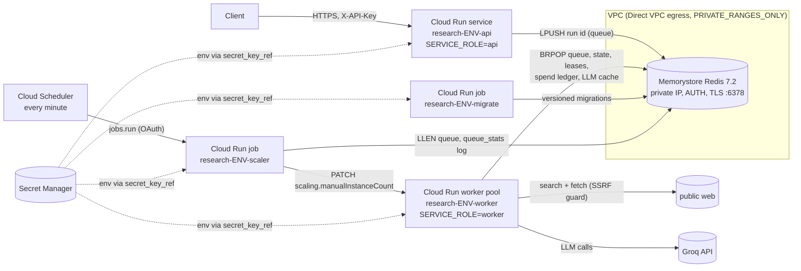

# Runbook: Multi-Agent Research Assistant on Google Cloud Run

Status: **deploy-ready; not applied (no cloud account connected).** Every command below was written against the
hashicorp/google provider 8.7.0 docs and the current `gcloud` reference. None of it has been run against a real
project yet, so treat the first deploy as a supervised dry run.

## Topology



| Piece | Resource | Notes |
|---|---|---|
| API | `google_cloud_run_v2_service` | min/max instances, concurrency 40, 1 vCPU / 512 MiB, startup probe `/readyz`, liveness `/healthz`, request-based billing (it does no background work) |
| Worker | `google_cloud_run_v2_worker_pool` | MANUAL scaling driven by the scaler job between `worker_min_instances` and `worker_max_instances`, 1 vCPU / 1 GiB, same probes on port 8102, no ingress |
| Scaler | `google_cloud_run_v2_job` + `google_cloud_scheduler_job` | `research-assistant scale-workers` every minute; see [Scaling](#scaling-queue-depth-scaler) |
| Migrations | `google_cloud_run_v2_job` | `research-assistant migrate`, run by CD before each deploy |
| Monitoring | `monitoring.tf` | uptime check, SLO + burn-rate alerts, 5xx, p95 latency, saturation, queue, degraded-report rate, Redis memory, scaler failures; see [Alerts](#alerts) |
| State | `google_redis_instance` | BASIC (staging) / STANDARD_HA (prod), AUTH, `SERVER_AUTHENTICATION` TLS, RDB hourly, `noeviction` |
| Secrets | `google_secret_manager_secret` x4 | created empty; values added out of band (`smoke-api-key` is readable by the CI deployer, nothing else is) |
| Images | `google_artifact_registry_repository` | immutable tags, keep 20 most recent, deploys by digest |
| Identity | 5 service accounts (api, worker, migrate, scaler, scheduler) | no project roles; per-secret `secretAccessor`, scaler = `run.developer` on the worker pool only, scheduler = `run.invoker` on the scaler job only |

### Worker topology (why a worker pool)

`POST /research` returns 202 and the run continues for minutes. A request-billed Cloud Run service throttles CPU
outside requests, so a background thread would stall. Options checked against provider 8.7.0:

| Option | Exists in provider? | Pros | Cons |
|---|---|---|---|
| **Worker pool** (`google_cloud_run_v2_worker_pool`) - chosen | yes (GA resource) | built for pull-based work; CPU always on; no URL/ingress at all; cheaper per vCPU-second than services (see SLO.md); probes supported | no built-in signal for a Redis queue, so this repo adds a queue-depth scaler job ([Scaling](#scaling-queue-depth-scaler)); rollout is by instance split, not traffic tags; newer product, so fewer examples |
| Service with instance-based billing (`resources.cpu_idle = false`, `min_instance_count >= 1`) | yes | familiar `gcloud run deploy` / tags; CPU/concurrency autoscaling | billed at the service rate for the whole instance lifetime; it still has a URL that must be locked down (internal ingress + IAM); request-based autoscaling signals do not reflect queue depth either |
| Background thread in the API service (the local `all` role) | n/a | simplest | CPU throttled between requests; scale-in kills runs; **not used in the cloud** |

The code supports all three through `SERVICE_ROLE` (`api`, `worker`, `all`), so switching the worker to a service
means changing Terraform only.

### Egress (the fetcher must reach the open web)

- Cloud Run uses Direct VPC egress with `egress = PRIVATE_RANGES_ONLY`. Only private destinations (Memorystore)
  enter the VPC. Public destinations use Cloud Run's internet egress.
- The fetcher follows search results to arbitrary public sites by design. A Cloud NAT or egress firewall can't
  express "the public web except attacker-chosen internal targets", so it can't allowlist this path. The control is the
  SSRF guard in code ([`fetch/ssrf.py`](../src/research_assistant/fetch/ssrf.py)): http/https on 80/443 only,
  every DNS answer must be a global IP (RFC 1918, CGNAT, link-local and metadata `169.254.169.254` /
  `fd20:ce::254` are blocked), the connection is pinned to the validated IP, and every redirect is re-validated.
  Tests: `tests/test_ssrf.py` (including `metadata.google.internal` and a Memorystore-style private IP).
- Defence in depth inside the VPC: the firewall allows egress only to the Memorystore `/29` on tcp/6378 and
  denies all other private ranges (`network.tf`).
- The metadata server can't be firewalled from Cloud Run (the platform needs it to mint tokens). If the guard
  failed anyway, a stolen token could read only that workload's own secrets, because the runtime service accounts
  have no project-level roles.

## Scaling (queue-depth scaler)

The worker pool's provider block offers `scaling_mode = "MANUAL"` (fixed `manual_instance_count`) and `"AUTOMATIC"`
(`min_instance_count` / `max_instance_count`); both exist in hashicorp/google 8.7 (checked with
`terraform providers schema -json`). Neither reads the Redis queue. Google's documented way to scale a worker pool on
an external queue is [CREMA](https://cloud.google.com/run/docs/configuring/workerpools/crema-autoscaling) (a KEDA-based
autoscaler service; its scaler list includes Redis Lists). This repo uses a smaller, testable equivalent instead:

- **Cloud Scheduler** (`google_cloud_scheduler_job.scaler`, every minute, `retry_count = 0`) calls the Cloud Run
  Admin API v2 [`jobs.run`](https://cloud.google.com/run/docs/reference/rest/v2/projects.locations.jobs/run) for the
  **scaler job** with an OAuth token of the `scheduler` service account (`run.invoker` on that job only).
- The job runs `research-assistant scale-workers` ([`scaler.py`](../src/research_assistant/scaler.py)): it reads
  the queue (`LLEN ra:queue`, unfinished runs, age of the oldest queued run), logs one
  `queue_stats queue_depth=... oldest_queued_age_s=...` line, computes
  `ceil(max(unfinished runs, queue depth) / MAX_CONCURRENT_RUNS)` clamped to `[worker_min_instances,
  worker_max_instances]`, scales in by at most one instance per minute, never scales up while the kill switch is on,
  and PATCHes `scaling.manualInstanceCount` through
  [`workerPools.patch`](https://cloud.google.com/run/docs/reference/rest/v2/projects.locations.workerPools/patch)
  with `updateMask=scaling.manualInstanceCount`.
- Terraform sets the initial count (`worker_instances`) and then ignores `scaling[0].manual_instance_count`, so a
  `terraform apply` does not undo the scaler.
- Scale-in is safe: Cloud Run sends SIGTERM, the worker checkpoints and requeues its runs (see
  [Graceful shutdown](#graceful-shutdown-what-happens-on-sigterm)).
- Reaction time: one Cloud Scheduler tick (1 min) plus instance start-up. With `worker_min_instances = 0`
  (staging) the first run after an idle period waits for that.
- Not verified against a live project: the PATCH body/updateMask follow the REST reference; the unit tests use a mock
  Admin API (`tests/test_hardening.py::test_scaler_patches_manual_instance_count_via_admin_api`).

```bash
gcloud run jobs execute research-prod-scaler --region REGION --wait                 # one scaling pass now
gcloud run jobs execute research-prod-scaler --region REGION --wait --args=queue-stats   # report only
gcloud scheduler jobs pause research-prod-scaler --location REGION                  # freeze the pool size
gcloud run worker-pools update research-prod-worker --region REGION --instances 4   # manual override (paused scaler)
```

## One-time GCP bootstrap

Run these once with an owner account. Replace `PROJECT`, `REGION`, `OWNER/REPO` and the bucket name.

```bash
gcloud config set project PROJECT
gcloud services enable iamcredentials.googleapis.com sts.googleapis.com run.googleapis.com \
  artifactregistry.googleapis.com secretmanager.googleapis.com redis.googleapis.com compute.googleapis.com

# 1) Terraform state bucket (private, versioned)
gcloud storage buckets create gs://PROJECT-tfstate --location=REGION --uniform-bucket-level-access \
  --public-access-prevention
gcloud storage buckets update gs://PROJECT-tfstate --versioning

# 2) Deployer service account used by GitHub Actions
gcloud iam service-accounts create gh-deployer --display-name="GitHub Actions deployer"
for role in roles/run.developer roles/artifactregistry.writer; do
  gcloud projects add-iam-policy-binding PROJECT \
    --member="serviceAccount:gh-deployer@PROJECT.iam.gserviceaccount.com" --role="$role"
done
# (actAs on the three runtime SAs is granted by Terraform via var.deployer_service_account)

# 3) Workload Identity Federation: pool + GitHub OIDC provider restricted to this repository
gcloud iam workload-identity-pools create github --location=global --display-name="GitHub Actions"
gcloud iam workload-identity-pools providers create-oidc github-repo --location=global \
  --workload-identity-pool=github --issuer-uri="https://token.actions.githubusercontent.com" \
  --attribute-mapping="google.subject=assertion.sub,attribute.repository=assertion.repository,attribute.ref=assertion.ref" \
  --attribute-condition="assertion.repository=='OWNER/REPO' && assertion.ref=='refs/heads/main'"
PROJECT_NUMBER=$(gcloud projects describe PROJECT --format='value(projectNumber)')
gcloud iam service-accounts add-iam-policy-binding gh-deployer@PROJECT.iam.gserviceaccount.com \
  --role=roles/iam.workloadIdentityUser \
  --member="principalSet://iam.googleapis.com/projects/${PROJECT_NUMBER}/locations/global/workloadIdentityPools/github/attribute.repository/OWNER/REPO"

# 4) GitHub repository variables (not secrets; nothing secret is stored in GitHub)
gh variable set GCP_PROJECT_ID  --body PROJECT
gh variable set GCP_REGION      --body REGION
gh variable set GCP_WIF_PROVIDER --body "projects/${PROJECT_NUMBER}/locations/global/workloadIdentityPools/github/providers/github-repo"
gh variable set GCP_DEPLOY_SA   --body "gh-deployer@PROJECT.iam.gserviceaccount.com"
# 5) GitHub environments: create `staging` and `production`; add required reviewers to `production`
#    (Settings -> Environments). Required reviewers on a PRIVATE repo need a paid GitHub plan.
```

### First apply (per environment)

The services need an image at creation time. Create the registry first, push one image, then apply everything.

```bash
cd infra/terraform/envs/staging            # or envs/prod
terraform init -backend-config="bucket=PROJECT-tfstate" -backend-config="prefix=research-assistant/staging"
export TF_VAR_project_id=PROJECT TF_VAR_region=REGION \
       TF_VAR_deployer_service_account=gh-deployer@PROJECT.iam.gserviceaccount.com
terraform apply -target=module.research_assistant.google_artifact_registry_repository.images \
  -var image=placeholder@sha256:0000000000000000000000000000000000000000000000000000000000000000

REPO=REGION-docker.pkg.dev/PROJECT/research-staging/research-assistant
gcloud auth configure-docker REGION-docker.pkg.dev
docker build -t $REPO:bootstrap . && docker push $REPO:bootstrap
IMAGE=$(docker inspect --format='{{index .RepoDigests 0}}' $REPO:bootstrap)

# Secrets: add values BEFORE the full apply (a revision can't start with an empty secret)
gcloud secrets versions add research-staging-groq-api-key --data-file=-       # paste key, Ctrl-D
openssl rand -hex 24 | gcloud secrets versions add research-staging-research-api-keys --data-file=-
openssl rand -hex 24 | gcloud secrets versions add research-staging-smoke-api-key --data-file=-   # deploy smoke only
terraform apply -target=module.research_assistant.google_redis_instance.state -var image=$IMAGE
gcloud redis instances get-auth-string research-staging-state --region REGION --format='value(authString)' \
  | gcloud secrets versions add research-staging-redis-auth --data-file=-

terraform apply -var image=$IMAGE
gcloud run jobs execute research-staging-migrate --region REGION --wait
SMOKE_API_KEY="$(gcloud secrets versions access latest --secret research-staging-smoke-api-key)" \
  python3 scripts/smoke.py --base-url "$(terraform output -raw api_url)" --run-timeout 300 --json-out smoke.json
```

Set `TF_VAR_alert_email=oncall@example.com` before `apply` to create the email notification channel (without it the
alert policies exist but notify nobody).

After this, every push to `main` deploys through `.github/workflows/deploy.yml`.

## Deploy (normal path = CD)

`deploy.yml` runs on every push to `main` (or manually with `gh workflow run deploy`):

1. **build**: `docker build`, push to `research-staging`, and sign the **digest** keylessly with cosign
   (Sigstore, GitHub OIDC identity of this workflow on `main`).
2. **deploy-staging**: `cosign verify` the digest (certificate identity = this workflow on `main`, issuer
   `https://token.actions.githubusercontent.com`), update and execute the migrate job, record rollback targets
   (API: revision at 100%; worker pool: [`scripts/worker_pool_revision.sh`](../scripts/worker_pool_revision.sh)),
   deploy the API revision with `--no-traffic --tag c-<sha>`, run a quick [`scripts/smoke.py`](../scripts/smoke.py)
   against the tag URL (`--no-run-completion`), move 100% to latest, deploy the worker pool and the scaler job image,
   then run the **full smoke** against the service URL (a real, budget-capped research run that must complete with
   resolving citations). On failure the API and the worker pool go back to the recorded revisions.
3. **deploy-prod** waits for approval on the `production` environment. It then:
   - verifies the signature again and promotes the same digest to `research-prod` with `crane copy` (digest checked)
   - runs migrations and records the current API / worker-pool revisions as rollback targets
   - deploys with no traffic and runs the quick smoke against the tag URL
   - moves 10% to the canary and runs the **full smoke against the canary revision's tag URL**, then moves 100% and
     runs the quick smoke against the service URL
   - deploys the worker pool and the scaler job image

   If any step fails, `update-traffic` / `update-instance-split` puts 100% back on the recorded revisions. Smoke
   JSON summaries are uploaded as workflow artifacts (`smoke-staging`, `smoke-prod`). The deploy smoke uses the
   dedicated `research-ENV-smoke-api-key` secret ([`scripts/deploy_smoke.sh`](../scripts/deploy_smoke.sh)); each full
   smoke creates one real run (budget-capped at `BUDGET_MAX_RUN_USD`, measured mean $0.0009) and spends one minute's
   POST rate limit of that key.

Manual deploy of a known digest (same steps by hand):

```bash
IMAGE=REGION-docker.pkg.dev/PROJECT/research-prod/research-assistant@sha256:<digest>
cosign verify REGION-docker.pkg.dev/PROJECT/research-staging/research-assistant@sha256:<digest> \
  --certificate-identity https://github.com/niravpatidar37/tracedresearch/.github/workflows/deploy.yml@refs/heads/main \
  --certificate-oidc-issuer https://token.actions.githubusercontent.com
gcloud run jobs update research-prod-migrate --region REGION --image $IMAGE && \
  gcloud run jobs execute research-prod-migrate --region REGION --wait
gcloud run deploy research-prod-api --region REGION --image $IMAGE --no-traffic --tag manual
bash scripts/deploy_smoke.sh research-prod-smoke-api-key "$(gcloud run services describe research-prod-api \
  --region REGION --format=json | jq -r '.status.traffic[] | select(.tag=="manual") | .url')" smoke.json --run-timeout 300
gcloud run services update-traffic research-prod-api --region REGION --to-revisions LATEST=10
gcloud run services update-traffic research-prod-api --region REGION --to-latest
gcloud run worker-pools deploy research-prod-worker --region REGION --image $IMAGE
gcloud run jobs update research-prod-scaler --region REGION --image $IMAGE
```

Infrastructure changes (not image changes) go through Terraform:
`terraform plan -var image=<current digest>` and then `apply`. Terraform ignores image/traffic drift, which CD owns.

## Verify

```bash
URL=$(gcloud run services describe research-prod-api --region REGION --format='value(status.url)')
bash scripts/deploy_smoke.sh research-prod-smoke-api-key "$URL" smoke.json --no-run-completion  # 17 checks, < 60 s
bash scripts/smoke_test.sh "$URL"                    # minimal: healthz + readyz only (no key needed)
curl -s "$URL/readyz"                                 # {"status":"ready","role":"api","schema_version":1,"kill_switch":false}
gcloud run services describe research-prod-api --region REGION --format='yaml(status.traffic)'
gcloud run worker-pools describe research-prod-worker --region REGION
gcloud logging read 'resource.type="cloud_run_revision" AND jsonPayload.severity>=WARNING' --limit 50 --freshness 1h
# end-to-end (costs a few LLM calls, under $0.002 at the measured $0.0009/run):
curl -s -X POST "$URL/research" -H "X-API-Key: $KEY" -H 'content-type: application/json' \
  -d '{"question":"How do sodium-ion batteries compare with lithium-ion on cost?"}'
```

## Rollback

```bash
# API: list revisions, send 100% to the last good one
gcloud run revisions list --service research-prod-api --region REGION
gcloud run services update-traffic research-prod-api --region REGION --to-revisions research-prod-api-00042-abc=100
# Worker pool: find the revision that holds the instances now / before (Admin API v2, documented fields
# instanceSplitStatuses[] and latestReadyRevision; gcloud's describe output shape is not relied on)
bash scripts/worker_pool_revision.sh PROJECT REGION research-prod-worker
gcloud run worker-pools update-instance-split research-prod-worker --region REGION \
  --to-revisions research-prod-worker-00017-xyz=100
# Infrastructure: revert the Terraform commit, then
terraform -chdir=infra/terraform/envs/prod plan -var image=<current digest> && terraform apply ...
```

Keyspace migrations are forward-only and must stay backward compatible with the previous release (add keys, do not
rename or delete them in the same release), so an image rollback never needs a data rollback.

## Rotate secrets

| Secret | Rotate |
|---|---|
| `research-ENV-groq-api-key` | create a new key at Groq, `gcloud secrets versions add ... --data-file=-`, then redeploy the worker so new instances read `latest` (`gcloud run worker-pools deploy research-ENV-worker --region REGION --image <current digest>`), then revoke the old key |
| `research-ENV-research-api-keys` | add the new key next to the old one (comma-separated), deploy a new API revision, tell clients, then remove the old key and deploy again |
| `research-ENV-redis-auth` | Memorystore has no in-place AUTH rotation. Disabling and re-enabling AUTH (`gcloud redis instances update research-ENV-state --region REGION --no-enable-auth`, then `--enable-auth`) generates a new string, and clients fail between the two steps. Engage the kill switch first (env flag; the Redis flag would be unreadable). Copy the new string with `get-auth-string` into a new secret version, then redeploy api + worker + job. The AUTH string is in Terraform state (provider attribute `auth_string`), so rotate it after any state-bucket exposure. |

Disable old versions after the rollout: `gcloud secrets versions disable <n> --secret <id>`.

## Kill switch (stop all LLM and tool calls)

**Propagation (accepted):** the Redis flag is cached for `KillSwitch.CACHE_S = 2` seconds per instance, so it takes
effect on every instance within about 2 s (CI smoke measures it: `kill_switch_refuses_new_runs` in
`results/smoke_local.json`). This is accepted: the switch protects against spend and abuse over minutes, a run makes
at most a few LLM calls in 2 s, and the hard per-run and monthly spend caps are enforced before every paid call
regardless. Caching keeps a Redis round trip off every LLM/tool call. The env flag takes effect when the new
revision starts (seconds to a minute).

Two independent switches; either one is enough:

```bash
# Fast (seconds, no redeploy): Redis flag read by every instance (cached for 2 s)
gcloud run jobs execute research-prod-migrate --region REGION --wait \
  --args=kill-switch,on,--reason=incident-123      # overrides the job's args for this execution
# Durable (survives a Redis loss): env flag via a new revision
gcloud run services update research-prod-api --region REGION --update-env-vars AGENT_KILL_SWITCH=1
gcloud run worker-pools update research-prod-worker --region REGION --update-env-vars AGENT_KILL_SWITCH=1
# (or set kill_switch = true in terraform.tfvars and apply)
```

While it is engaged:
- `POST /research` returns 503 with `Retry-After`.
- Workers stop consuming the queue and do not resume orphans.
- Runs in flight stop before their next LLM, search or fetch call, keep their last checkpoint, and go back on the queue.
- `GET` endpoints, `/healthz` and `/readyz` keep working. `/readyz` reports `"kill_switch": true`.

Release: `--args=kill-switch,off` or `AGENT_KILL_SWITCH=0`. Paused runs resume from their checkpoint.
The spend cap is a separate, always-on control: `LLM_SPEND_CAP_USD` / `P2_PROJECT_CAP_USD` per calendar month,
enforced in Redis before every paid call.

## Graceful shutdown (what happens on SIGTERM)

Cloud Run sends SIGTERM and waits 10 s before SIGKILL (scale-in, new revision, maintenance).

1. uvicorn stops accepting connections and closes open ones within 2 s (`--timeout-graceful-shutdown 2`). SSE
   streams end, and clients reconnect with `Last-Event-ID` to another instance.
2. The lifespan shutdown (`Service.shutdown`) marks the instance draining. `/readyz` returns 503, the queue
   consumer and resume loop stop, and every run in flight raises `Preempted` at its next node boundary or
   LLM/tool call. It keeps its last committed checkpoint (state is written atomically after every node), releases
   its lease and is pushed back to the head of the queue.
3. Runs still inside a long call after `SHUTDOWN_GRACE_S` (6 s) keep their lease until the process dies. The lease
   expires (`RUN_LEASE_TTL_S`, 15 s) and another instance's resume loop continues from the last checkpoint. The
   interrupted node is re-run, and its LLM calls are served from the shared Redis cache if they had finished.

## Alerts

Defined in [`monitoring.tf`](../infra/terraform/modules/research_assistant/monitoring.tf), per environment, sent to
the email channel from `alert_email`.

| Alert | Condition | Severity | First action |
|---|---|---|---|
| `/healthz uptime check failing` | uptime check on `/healthz` (60 s period) fails from 2+ locations for 2 min | CRITICAL | `curl $URL/healthz`; revision status; recent deploy -> roll back |
| `availability SLO fast burn` | burn rate > 14.4x over 1 h AND 5 min (SLO 99.5%, 5xx minus deliberate 503s) | CRITICAL (page) | logs of 5xx; roll back the last deploy if it correlates |
| `availability SLO slow burn` | burn rate > 6x over 6 h AND 30 min | WARNING (ticket) | look for a slow regression (Redis latency, a dependency) |
| `API 5xx ratio > 2%` | 5xx / all requests > 2% for 5 min (includes kill-switch 503s) | ERROR | `/readyz` (kill switch? Redis?) |
| `API p95 latency over the SLO` | p95 of non-SSE requests > `slo_latency_p95_s` (0.3 s) for 10 min, log-based metric | WARNING | Redis latency, CPU saturation |
| `instance saturation` | API CPU p99 > 85% / API at `api_max_instances` / worker CPU p99 > 90% / worker memory p99 > 90% | WARNING | raise max instances or lower `worker_max_concurrent_runs` |
| `run queue backlog` | queue depth > 20, or oldest queued run > 300 s, for 10 min; or no `queue_stats` for 10 min | ERROR | kill switch? scaler executions? at `worker_max_instances`? Groq 429s? |
| `degraded-report rate` | fallback reports / completed runs > 20% over 1 h (grounded-answer SLO 80%) | WARNING | group by `fallback_reason`: `writer_output_invalid` / `writer_model_unavailable` = provider; `*_budget` = budgets |
| `Memorystore memory > 80%` | `redis.googleapis.com/stats/memory/usage_ratio` > 0.8 for 10 min | ERROR | scale `redis_memory_gb`; lower `LLM_CACHE_TTL_S` |
| `scaler job executions failing` | > 3 failed scaler executions in 15 min | WARNING | scaler job logs; IAM (`run.developer` on the pool) |

Metric names and labels were checked against the hashicorp/google 8.7 schema and the GCP metrics list
(`run.googleapis.com/request_count`, `container/cpu/utilizations`, `container/memory/utilizations`,
`container/instance_count` for `cloud_run_revision` / `cloud_run_worker_pool`, `job/completed_execution_count`).
None of it has run against a real project yet.

## On-call checklist

1. **Acknowledge** the alert; note the time and the environment (`staging` / `prod`).
2. **Triage in 2 minutes:** `curl -s $URL/readyz` (status, `kill_switch`, schema), then
   `bash scripts/deploy_smoke.sh research-prod-smoke-api-key "$URL" smoke.json --no-run-completion --skip-rate-limit`.
   Any FAIL line points at the broken layer (auth, validation, Redis, SSE, ...).
3. **Did a deploy just happen?** `gh run list --workflow deploy -L 3`. If yes and the smoke fails: roll back
   ([Rollback](#rollback)) first, debug second.
4. **Spend or abuse?** Engage the kill switch (Redis flag, about 2 s) and check `run_finished ... usd=` in logs.
5. **Queue alerts:** check the scaler (`gcloud run jobs executions list --job research-prod-scaler --region REGION`),
   the worker pool size, and Groq 429s in the worker logs.
6. **Degraded-report alert:** not an outage. Users still get cited findings, marked `degraded: true`. Look at
   `fallback_reason` and the LLM provider status.
7. **Close out:** release the kill switch if engaged, run the full smoke (`--run-timeout 300`), write a short
   incident note (timeline, cause, fix, follow-up).

## Common incidents

| Symptom | Likely cause | Action |
|---|---|---|
| `/readyz` 503 `schema version 0 < 1: run migrate` | migrate job not run for this Redis | `gcloud run jobs execute research-ENV-migrate --region REGION --wait` |
| `/readyz` 503 `redis unavailable` | Memorystore maintenance/failover, wrong AUTH secret, VPC egress misconfigured | check `gcloud redis instances describe`; check the secret version; instances stay up (liveness is `/healthz`) and recover by themselves |
| Runs stay `queued` | worker pool at 0 instances, kill switch on, or workers crash-looping | `curl $URL/readyz` (kill_switch), `gcloud run worker-pools describe`, worker logs |
| Runs fail with `budget: ... project_usd` | monthly spend cap reached | expected; raise `llm_project_cap_usd` deliberately or wait for the month to roll over |
| Many `rate_limited` failovers / slow runs | Groq per-model TPM/RPD limits | lower `worker_max_concurrent_runs`; upgrade the Groq tier |
| Redis `OOM command not allowed` | `noeviction` and memory full | scale `redis_memory_gb`; lower `LLM_CACHE_TTL_S`; completed runs expire after 7 days |
| 429 from the API | per-key rate limit (`RATE_LIMIT_PER_MIN`) | expected; raise per environment if needed |
| Suspected prompt-injection or abuse | hostile pages or a leaked API key | engage the kill switch, rotate `research-api-keys`, review traces (`GET /research/{id}/trace`) |
