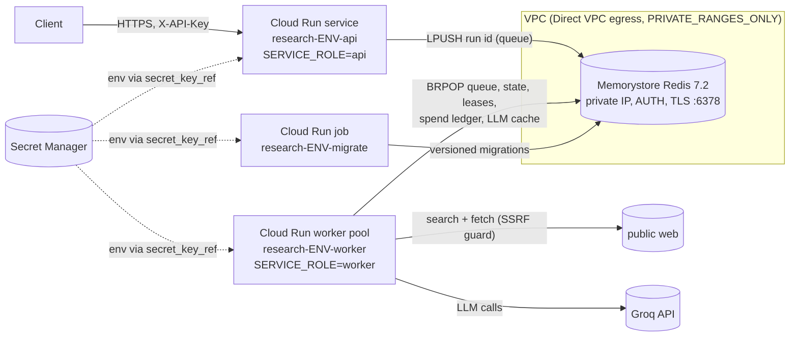

# Runbook: Multi-Agent Research Assistant on Google Cloud Run

Status: **deploy-ready; not applied (no cloud account connected).** Every command below was written against the
hashicorp/google provider 8.7.0 docs and the current `gcloud` reference. None of it has been run against a real
project yet, so treat the first deploy as a supervised dry run.

## Topology



| Piece | Resource | Notes |
|---|---|---|
| API | `google_cloud_run_v2_service` | min/max instances, concurrency 40, 1 vCPU / 512 MiB, startup probe `/readyz`, liveness `/healthz`, request-based billing (it does no background work) |
| Worker | `google_cloud_run_v2_worker_pool` | manual scaling (`worker_instances`), 1 vCPU / 1 GiB, same probes on port 8102, no ingress |
| Migrations | `google_cloud_run_v2_job` | `research-assistant migrate`, run by CD before each deploy |
| State | `google_redis_instance` | BASIC (staging) / STANDARD_HA (prod), AUTH, `SERVER_AUTHENTICATION` TLS, RDB hourly, `noeviction` |
| Secrets | `google_secret_manager_secret` x3 | created empty; values added out of band |
| Images | `google_artifact_registry_repository` | immutable tags, keep 20 most recent, deploys by digest |
| Identity | 3 service accounts (api, worker, migrate) | no project roles; per-secret `secretAccessor` only |

### Worker topology (why a worker pool)

`POST /research` returns 202 and the run continues for minutes. A request-billed Cloud Run service throttles CPU
outside requests, so a background thread would stall. Options checked against provider 8.7.0:

| Option | Exists in provider? | Pros | Cons |
|---|---|---|---|
| **Worker pool** (`google_cloud_run_v2_worker_pool`) - chosen | yes (GA resource) | built for pull-based work; CPU always on; no URL/ingress at all; cheaper per vCPU-second than services (see SLO.md); probes supported | scaling is `MANUAL` (fixed count) unless you adopt automatic mode or an external queue-depth autoscaler; rollout is by instance split, not traffic tags; newer product, so fewer examples |
| Service with instance-based billing (`resources.cpu_idle = false`, `min_instance_count >= 1`) | yes | familiar `gcloud run deploy` / tags; CPU/concurrency autoscaling | billed at the service rate for the whole instance lifetime; it still has a URL that must be locked down (internal ingress + IAM); request-based autoscaling signals do not reflect queue depth either |
| Background thread in the API service (the local `all` role) | n/a | simplest | CPU throttled between requests; scale-in kills runs; **not used in the cloud** |

The code supports all three through `SERVICE_ROLE` (`api`, `worker`, `all`), so switching the worker to a service
means changing Terraform only.

### Egress (the fetcher must reach the open web)

- Cloud Run uses Direct VPC egress with `egress = PRIVATE_RANGES_ONLY`. Only private destinations (Memorystore)
  enter the VPC. Public destinations use Cloud Run's internet egress.
- The fetcher follows search results to arbitrary public sites by design. A Cloud NAT or egress firewall can't
  express "the public web except attacker-chosen internal targets", so it can't allowlist this path. The control is the
  SSRF guard in code ([`fetch/ssrf.py`](../src/research_assistant/fetch/ssrf.py)): http/https on 80/443 only,
  every DNS answer must be a global IP (RFC 1918, CGNAT, link-local and metadata `169.254.169.254` /
  `fd20:ce::254` are blocked), the connection is pinned to the validated IP, and every redirect is re-validated.
  Tests: `tests/test_ssrf.py` (including `metadata.google.internal` and a Memorystore-style private IP).
- Defence in depth inside the VPC: the firewall allows egress only to the Memorystore `/29` on tcp/6378 and
  denies all other private ranges (`network.tf`).
- The metadata server can't be firewalled from Cloud Run (the platform needs it to mint tokens). If the guard
  failed anyway, a stolen token could read only that workload's own secrets, because the runtime service accounts
  have no project-level roles.

## One-time GCP bootstrap

Run these once with an owner account. Replace `PROJECT`, `REGION`, `OWNER/REPO` and the bucket name.

```bash
gcloud config set project PROJECT
gcloud services enable iamcredentials.googleapis.com sts.googleapis.com run.googleapis.com \
  artifactregistry.googleapis.com secretmanager.googleapis.com redis.googleapis.com compute.googleapis.com

# 1) Terraform state bucket (private, versioned)
gcloud storage buckets create gs://PROJECT-tfstate --location=REGION --uniform-bucket-level-access \
  --public-access-prevention
gcloud storage buckets update gs://PROJECT-tfstate --versioning

# 2) Deployer service account used by GitHub Actions
gcloud iam service-accounts create gh-deployer --display-name="GitHub Actions deployer"
for role in roles/run.developer roles/artifactregistry.writer; do
  gcloud projects add-iam-policy-binding PROJECT \
    --member="serviceAccount:gh-deployer@PROJECT.iam.gserviceaccount.com" --role="$role"
done
# (actAs on the three runtime SAs is granted by Terraform via var.deployer_service_account)

# 3) Workload Identity Federation: pool + GitHub OIDC provider restricted to this repository
gcloud iam workload-identity-pools create github --location=global --display-name="GitHub Actions"
gcloud iam workload-identity-pools providers create-oidc github-repo --location=global \
  --workload-identity-pool=github --issuer-uri="https://token.actions.githubusercontent.com" \
  --attribute-mapping="google.subject=assertion.sub,attribute.repository=assertion.repository,attribute.ref=assertion.ref" \
  --attribute-condition="assertion.repository=='OWNER/REPO' && assertion.ref=='refs/heads/main'"
PROJECT_NUMBER=$(gcloud projects describe PROJECT --format='value(projectNumber)')
gcloud iam service-accounts add-iam-policy-binding gh-deployer@PROJECT.iam.gserviceaccount.com \
  --role=roles/iam.workloadIdentityUser \
  --member="principalSet://iam.googleapis.com/projects/${PROJECT_NUMBER}/locations/global/workloadIdentityPools/github/attribute.repository/OWNER/REPO"

# 4) GitHub repository variables (not secrets; nothing secret is stored in GitHub)
gh variable set GCP_PROJECT_ID  --body PROJECT
gh variable set GCP_REGION      --body REGION
gh variable set GCP_WIF_PROVIDER --body "projects/${PROJECT_NUMBER}/locations/global/workloadIdentityPools/github/providers/github-repo"
gh variable set GCP_DEPLOY_SA   --body "gh-deployer@PROJECT.iam.gserviceaccount.com"
# 5) GitHub environments: create `staging` and `production`; add required reviewers to `production`
#    (Settings -> Environments). Required reviewers on a PRIVATE repo need a paid GitHub plan.
```

### First apply (per environment)

The services need an image at creation time. Create the registry first, push one image, then apply everything.

```bash
cd infra/terraform/envs/staging            # or envs/prod
terraform init -backend-config="bucket=PROJECT-tfstate" -backend-config="prefix=research-assistant/staging"
export TF_VAR_project_id=PROJECT TF_VAR_region=REGION \
       TF_VAR_deployer_service_account=gh-deployer@PROJECT.iam.gserviceaccount.com
terraform apply -target=module.research_assistant.google_artifact_registry_repository.images \
  -var image=placeholder@sha256:0000000000000000000000000000000000000000000000000000000000000000

REPO=REGION-docker.pkg.dev/PROJECT/research-staging/research-assistant
gcloud auth configure-docker REGION-docker.pkg.dev
docker build -t $REPO:bootstrap . && docker push $REPO:bootstrap
IMAGE=$(docker inspect --format='{{index .RepoDigests 0}}' $REPO:bootstrap)

# Secrets: add values BEFORE the full apply (a revision can't start with an empty secret)
gcloud secrets versions add research-staging-groq-api-key --data-file=-       # paste key, Ctrl-D
openssl rand -hex 24 | gcloud secrets versions add research-staging-research-api-keys --data-file=-
terraform apply -target=module.research_assistant.google_redis_instance.state -var image=$IMAGE
gcloud redis instances get-auth-string research-staging-state --region REGION --format='value(authString)' \
  | gcloud secrets versions add research-staging-redis-auth --data-file=-

terraform apply -var image=$IMAGE
gcloud run jobs execute research-staging-migrate --region REGION --wait
bash scripts/smoke_test.sh "$(terraform output -raw api_url)"
```

After this, every push to `main` deploys through `.github/workflows/deploy.yml`.

## Deploy (normal path = CD)

`deploy.yml` runs on every push to `main` (or manually with `gh workflow run deploy`):

1. **build**: `docker build` and push to `research-staging`. The job outputs the image **digest**.
2. **deploy-staging**: update and execute the migrate job, deploy the API revision with `--no-traffic --tag c-<sha>`,
   run `scripts/smoke_test.sh` against the tag URL (`/healthz` + `/readyz`), move 100% to latest, deploy
   the worker pool (its startup probe is `/readyz`), then smoke the service URL. On failure the API goes back to
   the previous revision.
3. **deploy-prod** waits for approval on the `production` environment. It then:
   - promotes the same digest to `research-prod` with `crane copy` and verifies the digest is unchanged
   - runs migrations
   - records the current revisions as rollback targets
   - deploys with no traffic and smokes the tag URL
   - moves 10% to the canary and smokes 5 times over 1 minute, then moves 100% and smokes again
   - deploys the worker pool

   If any step fails, `update-traffic` / `update-instance-split` puts 100% back on the recorded revisions.

Manual deploy of a known digest (same steps by hand):

```bash
IMAGE=REGION-docker.pkg.dev/PROJECT/research-prod/research-assistant@sha256:<digest>
gcloud run jobs update research-prod-migrate --region REGION --image $IMAGE && \
  gcloud run jobs execute research-prod-migrate --region REGION --wait
gcloud run deploy research-prod-api --region REGION --image $IMAGE --no-traffic --tag manual
bash scripts/smoke_test.sh "$(gcloud run services describe research-prod-api --region REGION --format=json \
  | jq -r '.status.traffic[] | select(.tag=="manual") | .url')"
gcloud run services update-traffic research-prod-api --region REGION --to-revisions LATEST=10
gcloud run services update-traffic research-prod-api --region REGION --to-latest
gcloud run worker-pools deploy research-prod-worker --region REGION --image $IMAGE
```

Infrastructure changes (not image changes) go through Terraform:
`terraform plan -var image=<current digest>` and then `apply`. Terraform ignores image/traffic drift, which CD owns.

## Verify

```bash
URL=$(gcloud run services describe research-prod-api --region REGION --format='value(status.url)')
bash scripts/smoke_test.sh "$URL"                    # healthz + readyz (Redis reachable, schema migrated)
curl -s "$URL/readyz"                                 # {"status":"ready","role":"api","schema_version":1,"kill_switch":false}
gcloud run services describe research-prod-api --region REGION --format='yaml(status.traffic)'
gcloud run worker-pools describe research-prod-worker --region REGION
gcloud logging read 'resource.type="cloud_run_revision" AND jsonPayload.severity>=WARNING' --limit 50 --freshness 1h
# end-to-end (costs a few LLM calls, under $0.002 at the measured $0.0009/run):
curl -s -X POST "$URL/research" -H "X-API-Key: $KEY" -H 'content-type: application/json' \
  -d '{"question":"How do sodium-ion batteries compare with lithium-ion on cost?"}'
```

## Rollback

```bash
# API: list revisions, send 100% to the last good one
gcloud run revisions list --service research-prod-api --region REGION
gcloud run services update-traffic research-prod-api --region REGION --to-revisions research-prod-api-00042-abc=100
# Worker pool
gcloud run worker-pools update-instance-split research-prod-worker --region REGION \
  --to-revisions research-prod-worker-00017-xyz=100
# Infrastructure: revert the Terraform commit, then
terraform -chdir=infra/terraform/envs/prod plan -var image=<current digest> && terraform apply ...
```

Keyspace migrations are forward-only and must stay backward compatible with the previous release (add keys, do not
rename or delete them in the same release), so an image rollback never needs a data rollback.

## Rotate secrets

| Secret | Rotate |
|---|---|
| `research-ENV-groq-api-key` | create a new key at Groq, `gcloud secrets versions add ... --data-file=-`, then redeploy the worker so new instances read `latest` (`gcloud run worker-pools deploy research-ENV-worker --region REGION --image <current digest>`), then revoke the old key |
| `research-ENV-research-api-keys` | add the new key next to the old one (comma-separated), deploy a new API revision, tell clients, then remove the old key and deploy again |
| `research-ENV-redis-auth` | Memorystore has no in-place AUTH rotation. Disabling and re-enabling AUTH (`gcloud redis instances update research-ENV-state --region REGION --no-enable-auth`, then `--enable-auth`) generates a new string, and clients fail between the two steps. Engage the kill switch first (env flag; the Redis flag would be unreadable). Copy the new string with `get-auth-string` into a new secret version, then redeploy api + worker + job. The AUTH string is in Terraform state (provider attribute `auth_string`), so rotate it after any state-bucket exposure. |

Disable old versions after the rollout: `gcloud secrets versions disable <n> --secret <id>`.

## Kill switch (stop all LLM and tool calls)

Two independent switches; either one is enough:

```bash
# Fast (seconds, no redeploy): Redis flag read by every instance (cached for 2 s)
gcloud run jobs execute research-prod-migrate --region REGION --wait \
  --args=kill-switch,on,--reason=incident-123      # overrides the job's args for this execution
# Durable (survives a Redis loss): env flag via a new revision
gcloud run services update research-prod-api --region REGION --update-env-vars AGENT_KILL_SWITCH=1
gcloud run worker-pools update research-prod-worker --region REGION --update-env-vars AGENT_KILL_SWITCH=1
# (or set kill_switch = true in terraform.tfvars and apply)
```

While it is engaged:
- `POST /research` returns 503 with `Retry-After`.
- Workers stop consuming the queue and do not resume orphans.
- Runs in flight stop before their next LLM, search or fetch call, keep their last checkpoint, and go back on the queue.
- `GET` endpoints, `/healthz` and `/readyz` keep working. `/readyz` reports `"kill_switch": true`.

Release: `--args=kill-switch,off` or `AGENT_KILL_SWITCH=0`. Paused runs resume from their checkpoint.
The spend cap is a separate, always-on control: `LLM_SPEND_CAP_USD` / `P2_PROJECT_CAP_USD` per calendar month,
enforced in Redis before every paid call.

## Graceful shutdown (what happens on SIGTERM)

Cloud Run sends SIGTERM and waits 10 s before SIGKILL (scale-in, new revision, maintenance).

1. uvicorn stops accepting connections and closes open ones within 2 s (`--timeout-graceful-shutdown 2`). SSE
   streams end, and clients reconnect with `Last-Event-ID` to another instance.
2. The lifespan shutdown (`Service.shutdown`) marks the instance draining. `/readyz` returns 503, the queue
   consumer and resume loop stop, and every run in flight raises `Preempted` at its next node boundary or
   LLM/tool call. It keeps its last committed checkpoint (state is written atomically after every node), releases
   its lease and is pushed back to the head of the queue.
3. Runs still inside a long call after `SHUTDOWN_GRACE_S` (6 s) keep their lease until the process dies. The lease
   expires (`RUN_LEASE_TTL_S`, 15 s) and another instance's resume loop continues from the last checkpoint. The
   interrupted node is re-run, and its LLM calls are served from the shared Redis cache if they had finished.

## Common incidents

| Symptom | Likely cause | Action |
|---|---|---|
| `/readyz` 503 `schema version 0 < 1: run migrate` | migrate job not run for this Redis | `gcloud run jobs execute research-ENV-migrate --region REGION --wait` |
| `/readyz` 503 `redis unavailable` | Memorystore maintenance/failover, wrong AUTH secret, VPC egress misconfigured | check `gcloud redis instances describe`; check the secret version; instances stay up (liveness is `/healthz`) and recover by themselves |
| Runs stay `queued` | worker pool at 0 instances, kill switch on, or workers crash-looping | `curl $URL/readyz` (kill_switch), `gcloud run worker-pools describe`, worker logs |
| Runs fail with `budget: ... project_usd` | monthly spend cap reached | expected; raise `llm_project_cap_usd` deliberately or wait for the month to roll over |
| Many `rate_limited` failovers / slow runs | Groq per-model TPM/RPD limits | lower `worker_max_concurrent_runs`; upgrade the Groq tier |
| Redis `OOM command not allowed` | `noeviction` and memory full | scale `redis_memory_gb`; lower `LLM_CACHE_TTL_S`; completed runs expire after 7 days |
| 429 from the API | per-key rate limit (`RATE_LIMIT_PER_MIN`) | expected; raise per environment if needed |
| Suspected prompt-injection or abuse | hostile pages or a leaked API key | engage the kill switch, rotate `research-api-keys`, review traces (`GET /research/{id}/trace`) |
